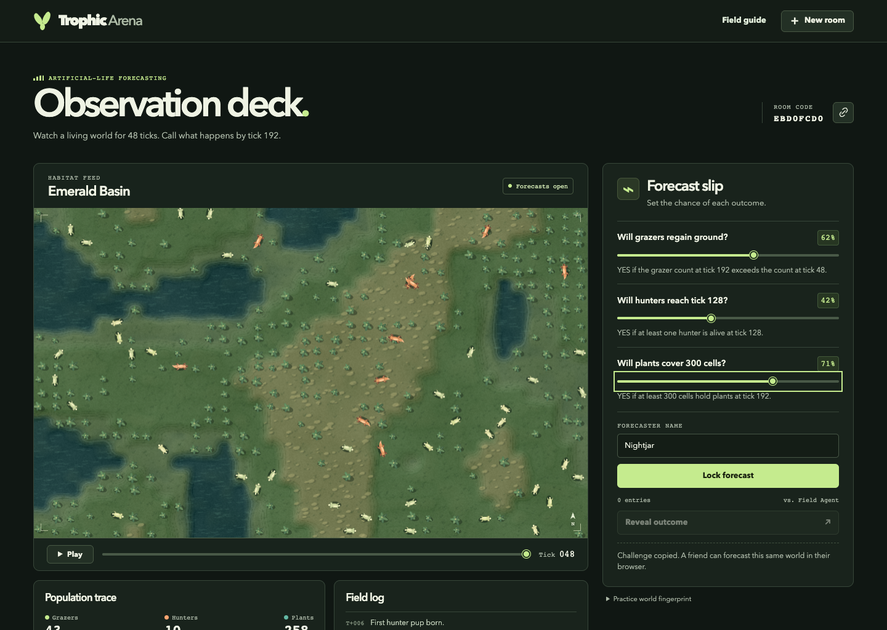

# Trophic Arena

Watch an artificial ecosystem for 48 ticks. Predict whether the grazers recover, whether the hunters survive, and whether plants reclaim the map. Lock your probabilities, reveal the rest of the world, and see if you beat **Field Agent**, a forecaster trained on 128 other worlds.

**[Play in your browser](https://dylanlaewe.github.io/trophic-arena/)** · [Try a handpicked Emerald Basin world](https://dylanlaewe.github.io/trophic-arena/?challenge=ebd0fcd0252148b9a2a7c0d5d72cd4b3efa6abf151fd51e8cc251dbfa0ebbbe0) · [Opportunity research](RESEARCH.md)



## One world, two endings

Grazers move toward plants and away from hunters. Hunters follow nearby prey. Each animal spends energy, ages, and can pass a sensory trait to its offspring, with occasional mutation. Three biomes have different plant-growth rates. A seeded rain or dry front can alter the population trajectory after you enter your predictions.

Once your round settles, **Test a highland refuge** replays it with one change. From tick 49, hunters can enter highland cells but cannot catch grazers there. The two runs share their entire opening, weather, and plant-growth attempts. The comparison shows how the two grazer populations diverge and what remains at tick 192. It is an experiment in a toy ecology.

## Play with friends or bring a bot

The hosted GitHub Pages game is solo. Copying a challenge gives someone else the same world and an independent score. Its URL contains the simulation seed. For a competition where the seed stays on the host until the reveal, run the included multiplayer server. It needs **Node.js 22.13 or newer** and uses only built-in modules.

```sh
git clone https://github.com/dylanlaewe/trophic-arena.git
cd trophic-arena
npm start
```

Open [the local arena](http://127.0.0.1:3000). To host a group on your Wi-Fi, start it with `HOST=0.0.0.0 npm start`, open the host’s LAN address on port 3000, and copy the room link. The browser that created the room holds its reveal key. Up to 64 named entries plus the built-in opponent can play. The host reveals when everyone has submitted.

Outside bots can use the same HTTP interface as the browser. Replace the URL with a multiplayer room link. The three arguments follow the question order printed by `observe`.

```sh
node cli.mjs observe 'http://127.0.0.1:3000/?room=ROOMCODE'
node cli.mjs forecast 'http://127.0.0.1:3000/?room=ROOMCODE' 'My bot' 0.65 0.30 0.72
```

| Request | Result |
| --- | --- |
| `POST /api/rooms` with `{}` | New code, seed commitment and private host token |
| `GET /api/rooms/CODE` | Terrain, questions and observations through the cutoff while open. Complete replay and leaderboard after settlement |
| `GET /api/rooms/CODE/status` | Phase and entrant count |
| `POST /api/rooms/CODE/forecasts` | Submit a name and a probabilities object keyed by question ID. Identical retries are accepted |
| `POST /api/rooms/CODE/settle` | Close entries and reveal the outcome using `Authorization: Bearer HOST_TOKEN` |
| `GET /api/rooms/CODE/refuge` | Population traces from the post-settlement experiment |

The server defaults to `HOST=127.0.0.1` and `PORT=3000`. `ARENA_DATA_DIR` selects the folder holding the SQLite database. Its default is `.arena-data/`. Keep that folder across restarts. Rooms are designed for trusted groups with self-selected names.

## Benchmark

Field Agent uses grazer, hunter and plant counts at ticks 0, 24 and 48. It log-transforms and standardizes those nine features, finds the 12 nearest reference worlds, and smooths their outcome frequencies toward the training base rates. Each entrant sees the same observation window. One score per round is `100 × (1 − mean Brier loss)`. An all-50% ticket scores 75.

| Forecast | Mean Brier loss on 64 held-out worlds ↓ |
| --- | ---: |
| Field Agent | 0.1936 |
| Training-set frequency for each event | 0.2247 |
| 50% on every event | 0.2500 |

That is a 13.9% reduction in mean squared probability error against the frequency baseline across 192 binary outcomes. The 64 worlds are the independent units. These results apply to this engine and this test split. Reproduce them with `node scripts/calibrate.mjs`. [Per-question results](data/benchmark.json) · [Training data](data/reference-worlds.json)

## Verify a replay

Before playing a multiplayer round, save the displayed SHA-256 commitment. After settlement, download the replay receipt. The verifier checks the revealed seed and engine version against that commitment, regenerates every observation and outcome, reconstructs the bot’s ticket, and recalculates the leaderboard. It cannot authenticate player identities or prove a submitted ticket was included. Keep your copy of the ticket if you need to check inclusion.

```sh
node cli.mjs verify path/to/receipt.json YOUR_SAVED_COMMITMENT
npm test
npm run build:pages
```

The Pages build writes a static site to `dist/`. The GitHub workflow runs tests before publishing it. Keep the corresponding source revision to replay a receipt from an older engine.
